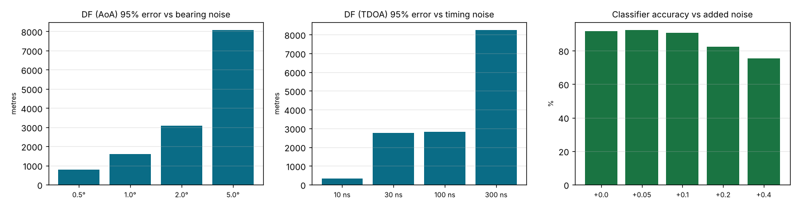

# Orca — Monte Carlo validation report

Generated 2026-11-21 06:24 UTC · 1500 trials per case · seed 1 · 14s

All trials run over the actual Orca modules (`orca.df`, `orca.tropo`, `orca.intel`, `orca.adapters`, `orca.mesh`). Figures in `figs/`.

## Direction finding — error envelope

Random emitter and 3–6 nodes in a ~40 km area; Gaussian measurement noise.

| Method | Noise | Median | CEP95 (95% within) |
|---|---|---|---|
| AoA | 0.5° bearing | 170 m | 772 m |
| AoA | 1.0° bearing | 354 m | 1594 m |
| AoA | 2.0° bearing | 709 m | 3085 m |
| AoA | 5.0° bearing | 1708 m | 8062 m |
| TDOA | 10 ns timing | 13 m | 325 m |
| TDOA | 30 ns timing | 29 m | 2754 m |
| TDOA | 100 ns timing | 100 m | 2803 m |
| TDOA | 300 ns timing | 281 m | 8234 m |

## GNSS jamming detector — detection vs false alarm

False-alarm rate on clean sky: **0.0%**.

| C/N0 drop | Probability of detection |
|---|---|
| 8 dB | 15% |
| 12 dB | 95% |
| 16 dB | 100% |
| 20 dB | 100% |

## Modulation classifier — robustness to noise

| Added noise σ | Accuracy |
|---|---|
| +0.0 | 92% |
| +0.05 | 92% |
| +0.1 | 90% |
| +0.2 | 82% |
| +0.4 | 75% |

Confusion matrix (rows = truth) at the nominal level:

| truth \ pred | empty | am | fm | fsk | psk | ofdm | pulse | chirp |
|---|---|---|---|---|---|---|---|---|
| empty | 100 | 0 | 0 | 0 | 0 | 0 | 0 | 0 |
| am | 0 | 100 | 0 | 0 | 0 | 0 | 0 | 0 |
| fm | 0 | 0 | 65 | 35 | 0 | 0 | 0 | 0 |
| fsk | 0 | 0 | 27 | 73 | 0 | 0 | 0 | 0 |
| psk | 0 | 0 | 0 | 3 | 97 | 0 | 0 | 0 |
| ofdm | 0 | 0 | 0 | 0 | 0 | 100 | 0 | 0 |
| pulse | 0 | 3 | 0 | 0 | 0 | 0 | 97 | 0 |
| chirp | 0 | 0 | 0 | 0 | 0 | 0 | 0 | 100 |

## Troposcatter — availability (Monte Carlo fading)

| Path | Predicted | Median SNR | Availability (median, 10th pct) |
|---|---|---|---|
| Barbados-St Lucia 2 m FT8 | reliable | 40.0 dB | 100%, 100% |
| Barbados-St Vincent 70 cm FT8 | reliable | 40.0 dB | 100%, 100% |
| Barbados-Grenada 2 m SSB | reliable | 39.8 dB | 100%, 100% |
| Long path 2 m SSB 500 km | reliable | 26.8 dB | 100%, 99% |

## Mesh — value of store-and-forward on a fading link

Delivery fraction over a randomly fading link:

- Without store-and-forward: **76%**
- With store-and-forward: **100%**

## Method and limits

- Monte Carlo over the real implementation, fixed seed, reproducible.
- Noise and fading are modelled; this is algorithm validation, not a hardware-in-the-loop or field trial. Absolute numbers will shift on real receivers and real propagation.
- The troposcatter link budget is a calibrated amateur estimate (OZ1RH), not an ITU-R P.617 certification.
